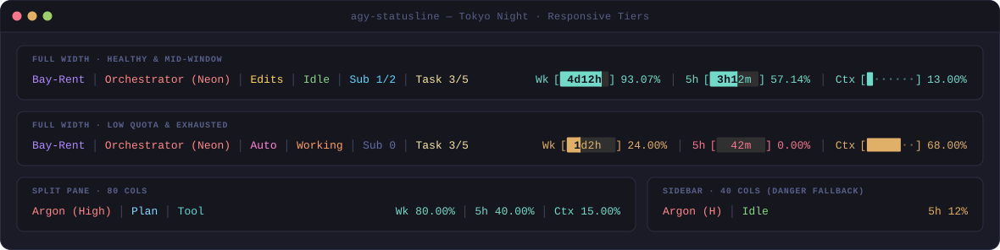

# agy-statusline

[](https://github.com/Verzional/agy-statusline/releases/latest)
[](go.mod)

Zero-dependency, sub-5ms statusline for **Antigravity CLI (`agy`)**.



## Installation

### macOS & Linux

```sh
curl -fsSL [https://raw.githubusercontent.com/Verzional/agy-statusline/main/install.sh](https://raw.githubusercontent.com/Verzional/agy-statusline/main/install.sh) | sh
```

Installs to `~/.local/bin/agy-statusline` (override with `INSTALL_DIR=/usr/local/bin`). Re-run anytime to update.

### Windows

Download `agy-statusline_v*_windows_amd64.zip` (or `arm64`) from [Releases](https://github.com/Verzional/agy-statusline/releases/latest) and extract `agy-statusline.exe` to a directory on your `PATH`.

### Go

```sh
go install [github.com/Verzional/agy-statusline@latest](https://github.com/Verzional/agy-statusline@latest)
```

### From Source

```sh
git clone [https://github.com/Verzional/agy-statusline.git](https://github.com/Verzional/agy-statusline.git)
cd agy-statusline && make install
```

## Configuration

Add `statusLine` to `~/.gemini/antigravity-cli/settings.json`:

```json
{
  "statusLine": {
    "type": "command",
    "command": "~/.local/bin/agy-statusline",
    "enabled": true
  }
}
```

Or merge it into an existing config with `jq`:

```sh
SETTINGS="$HOME/.gemini/antigravity-cli/settings.json"
[ -f "$SETTINGS" ] || printf '{}\n' > "$SETTINGS"
jq '.statusLine = {"type": "command", "command": "~/.local/bin/agy-statusline", "enabled": true}' "$SETTINGS" > "${SETTINGS}.tmp" && mv "${SETTINGS}.tmp" "$SETTINGS"
```

Start a new `agy` session (or run `/statusline` inside an active session) to enable it. 

Set `"stack_with_default": true` inside `"statusLine"` to keep Antigravity's default bar visible alongside this one.

## Telemetry

| Segment                  | Data Source                                    | Behavior                                                             |
| :----------------------- | :--------------------------------------------- | :------------------------------------------------------------------- |
| **Session**              | `stdin` payload / `conversation_metadata.json` | Truncated to 18 chars; falls back to 8-char session ID               |
| **Model & Effort**       | `stdin` payload                                | Strips vendor prefix in split panes; abbreviates effort in sidebars  |
| **Mode & Status**        | `stdin` payload                                | Color-coded by cycle mode (`Plan`, `Edits`, `Auto`, `Ask`) and state |
| **Subagents (`Sub`)**    | `stdin` payload                                | Hidden in split panes unless subagents are actively running          |
| **Tasks (`Task`)**       | `brain/<id>/task.md`                           | Counts `- [x]` / `- [ ]` checkboxes; falls back to `Art N`           |
| **Quotas (`Wk` / `5h`)** | `stdin` payload                                | Auto-routes Gemini, Argon, Claude, and GPT quota buckets             |
| **Context (`Ctx`)**      | `transcript.jsonl` / `stdin`                   | Syncs live token usage during turns; surfaces first under 50 cols    |
